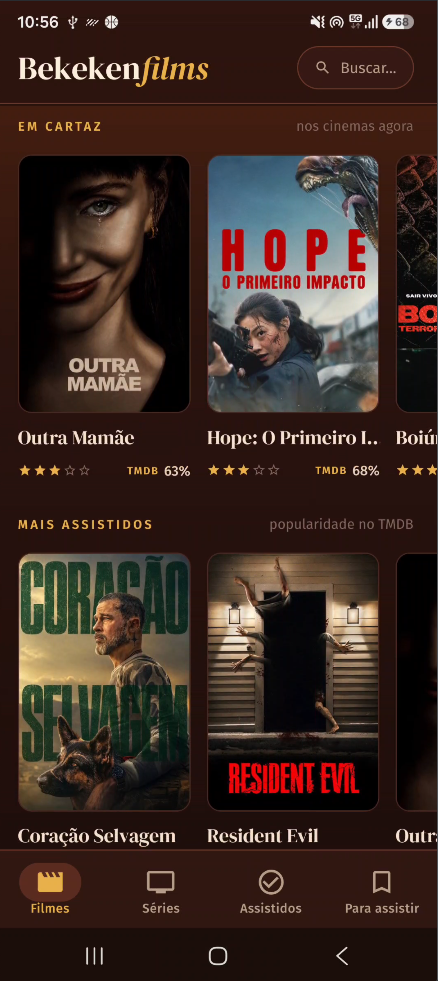
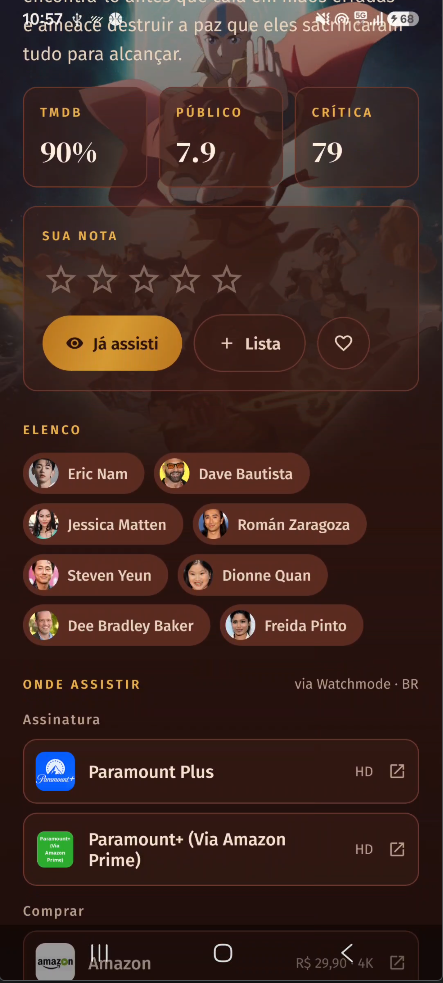
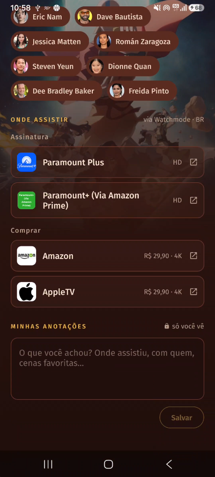
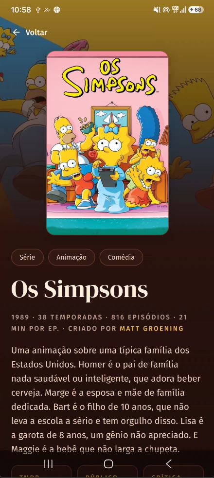
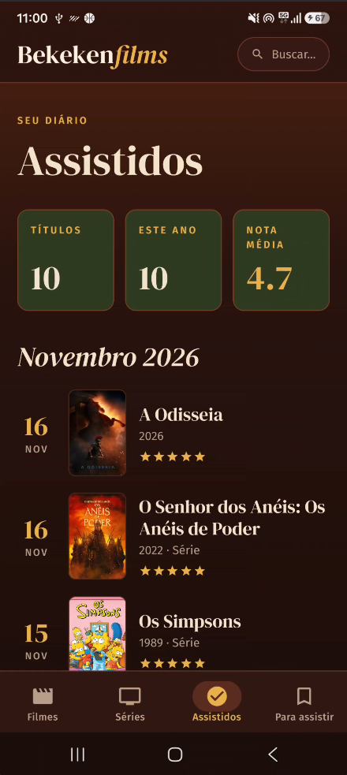

#+TITLE: Bekeken Films
#+AUTHOR: Hugo Oliveira

/"Bekeken" é "visto/assistido" em holandês./

Um app Android que fiz pra mim mesmo: um diariozinho de filmes e séries. Eu marco o
que assisti, dou nota, guardo o que quero ver depois e o app me sugere umas coisas
novas com base no que eu curti. Sem login, sem servidor, sem conta: tudo fica salvo
no próprio celular.

Os dados vêm do [[https://www.themoviedb.org/][TMDB]] (filmes, séries, elenco,
pôsteres) e do [[https://www.watchmode.com/][Watchmode]] (onde assistir no
Brasil, preços e notas do público/crítica).

* Como ele é

** Início
Destaque da semana, o que está em cartaz e o que está bombando no TMDB.

#+ATTR_HTML: :width 250px

#+ATTR_HTML: :width 250px

** Detalhes de um filme
Sinopse, notas (TMDB, público e crítica), elenco, onde assistir (assinatura,
aluguel, compra) e um campo de anotações que só você vê.

#+ATTR_HTML: :width 250px

#+ATTR_HTML: :width 250px

#+ATTR_HTML: :width 250px

** Séries e episódios
Séries têm temporadas, e cada episódio pode ser marcado e avaliado separadamente.

#+ATTR_HTML: :width 250px

#+ATTR_HTML: :width 250px

#+ATTR_HTML: :width 250px

** Assistidos e Para assistir
O diário com tudo que você viu (por mês, com nota média) e a sua lista de
"quero ver", junto com as recomendações.

#+ATTR_HTML: :width 250px

#+ATTR_HTML: :width 250px

** Recomendações
Duas abas: *por gêneros* e *por nota*. Mais sobre isso logo abaixo.

#+ATTR_HTML: :width 250px

#+ATTR_HTML: :width 250px

* O algoritmo de recomendação (é bem simples, de propósito)

Nada de machine learning, nada de servidor. É só contar gêneros. O código inteiro
está em [[./bekeken_films/src/services/recommend.ts][src/services/recommend.ts]] e
tem umas 100 linhas.

1. *Monta o seu perfil.* Olha tudo que você "curtiu" (deu coração ou nota >= 3) e
   soma pontos para cada gênero desses títulos:
   - *Por gêneros:* cada título curtido vale 1 ponto em cada gênero dele.
     Ex.: ={Aventura: 8, Ação: 8, Ficção científica: 6}=
   - *Por nota:* mesma ideia, mas cada título vale a nota que você deu (um 5 pesa
     mais que um 3). Só coração, sem nota, conta como 4.
2. *Pega candidatos.* Junta as listas de populares, mais bem avaliados e em cartaz
   do TMDB (filmes e séries) e tira o que você já assistiu ou já guardou.
3. *Dá uma nota pra cada candidato.* É a *média* dos pontos do seu perfil nos
   gêneros dele. Média e não soma, pra um filme não ganhar só por ter 5 gêneros.
   Empatou? Ganha quem tem nota maior no TMDB.
4. *Mostra o "% combina".* É a nota do candidato comparada com o seu gênero
   mais forte. O "Porque você curte X e Y" são os dois gêneros dele que mais
   pesam no seu perfil.

Se você ainda não curtiu nada, ele simplesmente mostra os mais bem avaliados.

É simples, erra bastante e é fácil de entender por que ele recomendou cada
coisa. Pra um app pessoal, tá ótimo.

* Rodando o projeto

O app é feito com [[https://expo.dev][Expo]] (React Native + TypeScript) e o
código fica dentro da pasta =bekeken_films/=.

** 1. Pegue as chaves das APIs (de graça)
- *TMDB:* crie uma conta e gere uma chave em
  [[https://www.themoviedb.org/settings/api]].
- *Watchmode:* crie uma conta em [[https://api.watchmode.com/]]. O plano grátis
  tem uma cota mensal pequena, mas o app guarda as respostas em cache. Sem essa
  chave o app funciona, só não mostra "onde assistir".

** 2. Configure o =.env=
#+begin_src shell
cd bekeken_films
cp .env.example .env
#+end_src

E preencha:
#+begin_src shell
EXPO_PUBLIC_TMDB_API_KEY=sua_chave_do_tmdb
EXPO_PUBLIC_WATCHMODE_API_KEY=sua_chave_do_watchmode
EXPO_PUBLIC_REGION=BR
EXPO_PUBLIC_LANGUAGE=pt-BR
#+end_src

** 3. Instale e rode
Você precisa de Node.js (e, para rodar no Android, do Android SDK).

#+begin_src shell
npm install
npm start          # abre o Expo; aperte "a" para Android ou "w" para web
#+end_src

Se você usa Nix, tem um [[https://devenv.sh][devenv]] na raiz que já traz
Node, Android SDK e NDK. É só rodar =devenv shell= antes.

** Extras
#+begin_src shell
npm test           # testes (recomendação, cache, biblioteca...)
npm run typecheck  # checagem de tipos
npm run stub       # servidor falso do TMDB/Watchmode, pra não gastar cota
#+end_src

O =npm run stub= imprime o comando certinho pra rodar o app (versão web)
apontando para o servidor falso.

* Gerando o seu próprio APK

Tem dois caminhos. Escolha um.

** Opção A: na nuvem, com EAS (mais fácil)
Não precisa de Android Studio. Precisa de uma conta (grátis) no
[[https://expo.dev][expo.dev]].

1. Logue e vincule o projeto à *sua* conta. O =app.json= vem sem =projectId=
   de propósito: o =eas init= cria o projeto no seu expo.dev e grava o ID
   sozinho no =app.json=.
   #+begin_src shell
   cd bekeken_films
   npx eas-cli@latest login
   npx eas-cli@latest init
   #+end_src
2. Cadastre as chaves no EAS. *Importante:* o =.env= está no =.gitignore=, então
   ele *não* é enviado para o build na nuvem. Sem isso o APK abre sem dados.
   #+begin_src shell
   npx eas-cli@latest env:create --environment preview --name EXPO_PUBLIC_TMDB_API_KEY --value sua_chave --visibility plaintext
   npx eas-cli@latest env:create --environment preview --name EXPO_PUBLIC_WATCHMODE_API_KEY --value sua_chave --visibility plaintext
   #+end_src
3. Gere o APK (o perfil =preview= do =eas.json= já está configurado pra sair um
   =.apk=):
   #+begin_src shell
   npx eas-cli@latest build -p android --profile preview
   #+end_src
4. No fim ele te dá um link/QR code. Baixe o APK no celular e instale (vai pedir
   para permitir "fontes desconhecidas").

** Opção B: local, com Gradle
Precisa do Android SDK + NDK + Java 17 instalados (o =devenv= resolve isso). Aqui
o =.env= é lido normalmente.

#+begin_src shell
cd bekeken_films
npx expo prebuild -p android        # gera a pasta android/
cd android
./gradlew assembleRelease
#+end_src

O APK fica em =android/app/build/outputs/apk/release/app-release.apk=. Por
padrão ele é assinado com a chave de debug, o que serve pra instalar no seu
celular, mas não pra publicar na Play Store.

Com o celular plugado no USB (depuração ativada), dá pra instalar direto:
#+begin_src shell
adb install app/build/outputs/apk/release/app-release.apk
#+end_src

* Bom saber
- Seus dados (notas, listas, anotações) ficam só no aparelho. Desinstalou, perdeu.
- As chaves vão "dentro" do APK (variáveis =EXPO_PUBLIC_*= são públicas). Não
  distribua um APK com a sua chave pra qualquer um.
- Este produto usa a API do TMDB, mas não é endossado nem certificado pelo TMDB.
